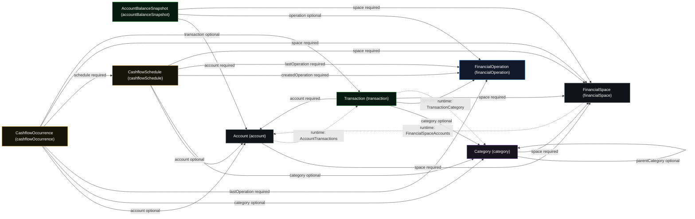
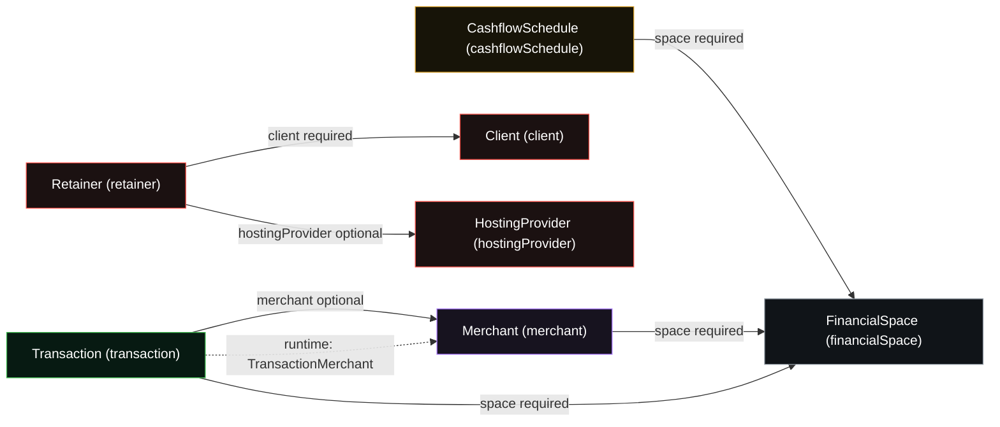

# Raven Data Atlas

This atlas is Raven's human-readable map of canonical models and connectivity. The generated block is a deterministic projection of schema authority plus the reviewed runtime-edge registry. It is documentation, not a competing schema.

## Authority

- Canonical model authority: `apps/schema/config/graph.mpdg`.
- Canonical parser: `apps/schema/scripts/mpdg-to-spec.ts`.
- Runtime relation-table registry: `scripts/raven-data-atlas/config.mjs`.
- Human interpretation and proposed bridges live below the generated markers.
- Generate with `pnpm docs:data-atlas`; verify freshness with `pnpm docs:data-atlas:check`.

<!-- BEGIN GENERATED DATA ATLAS -->

_Generated deterministically from schema authority. Edit the human-maintained section outside these markers._

## Generated Source Summary

- Schema: `apps/schema/config/graph.mpdg` (SHA-256 `2eaa9ee381d6775742e1a4919495ef5df3ff45d1240cd8bda46f25fb45f355a6`).
- Parser: `apps/schema/scripts/mpdg-to-spec.ts` (`parseFile` + `buildSpec`).
- Models: 35. Direct record references: 147. Self-references: 9.
- Runtime relation-table edges: 10. Parser warnings: 0.
- Relationship legend: solid arrows are direct MPDG `record<...>` fields; dashed arrows are reviewed runtime relation-table edges.

## Truth-Class Groups

- **Context:** `Account` (`account`), `FinancialSpace` (`financialSpace`), `User` (`u`)
- **Observed:** `AccountBalanceSnapshot` (`accountBalanceSnapshot`), `AccountTransfer` (`accountTransfer`), `StatementImport` (`statementImport`), `StatementRow` (`statementRow`), `StatementRowComponent` (`statementRowComponent`), `Transaction` (`transaction`)
- **Meaning / Review:** `Category` (`category`), `ClarificationTask` (`clarificationTask`), `ClassificationRule` (`classificationRule`), `Merchant` (`merchant`), `StatementIssue` (`statementIssue`), `StatementTransactionMatch` (`statementTransactionMatch`), `TaxCategory` (`taxCategory`), `TransactionPurpose` (`transactionPurpose`), `TransactionPurposeAssignment` (`transactionPurposeAssignment`), `TransactionTaxDeclaration` (`transactionTaxDeclaration`)
- **Accepted Future:** `CashflowOccurrence` (`cashflowOccurrence`), `CashflowSchedule` (`cashflowSchedule`)
- **Audit:** `FinancialOperation` (`financialOperation`), `StatementComponentResolutionClaim` (`statementComponentResolutionClaim`), `StatementPeriodClaim` (`statementPeriodClaim`), `StatementReconciliationEvent` (`statementReconciliationEvent`), `StatementSourceClaim` (`statementSourceClaim`), `StatementTransactionResolutionClaim` (`statementTransactionResolutionClaim`)
- **Derived:** `MonthlySnapshot` (`monthlySnapshot`), `StatementReconciliation` (`statementReconciliation`)
- **Business Reference:** `Client` (`client`), `HostingProvider` (`hostingProvider`), `Retainer` (`retainer`)
- **Unclassified (review required):** `AccountFacilitySnapshot` (`accountFacilitySnapshot`), `StatementLegacyResolution` (`statementLegacyResolution`), `StatementLegacyResolutionItem` (`statementLegacyResolutionItem`)

## Generated Model Catalog

| Model                               | Table                                 | Truth class                    | Identity expression                        | Authority       | Direct references                                                                                                                                                                                                                                                                                                                                                                                                                                                                                                                                                                                          | Description                                                                                                                  |
| ----------------------------------- | ------------------------------------- | ------------------------------ | ------------------------------------------ | --------------- | ---------------------------------------------------------------------------------------------------------------------------------------------------------------------------------------------------------------------------------------------------------------------------------------------------------------------------------------------------------------------------------------------------------------------------------------------------------------------------------------------------------------------------------------------------------------------------------------------------------- | ---------------------------------------------------------------------------------------------------------------------------- |
| Account                             | `account`                             | Context                        | `stringID<space, key>`                     | `source` (MPDG) | `space` -> `financialSpace` (required)                                                                                                                                                                                                                                                                                                                                                                                                                                                                                                                                                                     | Real-world bank, card, savings, loan, debt, investment, cash, or other account inside a financial space                      |
| AccountBalanceSnapshot              | `accountBalanceSnapshot`              | Observed                       | `key`                                      | `source` (MPDG) | `account` -> `account` (required)<br>`operation` -> `financialOperation` (optional)<br>`space` -> `financialSpace` (required)                                                                                                                                                                                                                                                                                                                                                                                                                                                                              | Immutable as-of account balance evidence with explicit freshness provenance                                                  |
| AccountFacilitySnapshot             | `accountFacilitySnapshot`             | Unclassified (review required) | `stringID<account, key>`                   | `source` (MPDG) | `account` -> `account` (required)<br>`operation` -> `financialOperation` (optional)<br>`space` -> `financialSpace` (required)<br>`statementImport` -> `statementImport` (optional)                                                                                                                                                                                                                                                                                                                                                                                                                         | Immutable dated evidence of a credit, overdraft, loan, or revolving facility and its exact observed or contractual terms     |
| AccountTransfer                     | `accountTransfer`                     | Observed                       | `key`                                      | `source` (MPDG) | `operation` -> `financialOperation` (required)<br>`sourceAccount` -> `account` (required)<br>`sourceSpace` -> `financialSpace` (required)<br>`sourceTransaction` -> `transaction` (required)<br>`targetAccount` -> `account` (required)<br>`targetSpace` -> `financialSpace` (required)<br>`targetTransaction` -> `transaction` (required)                                                                                                                                                                                                                                                                 | Source-authority aggregate linking two exact observed transfer legs between tracked accounts                                 |
| CashflowOccurrence                  | `cashflowOccurrence`                  | Accepted Future                | `stringID<schedule, scheduledDueOn>`       | `source` (MPDG) | `account` -> `account` (optional)<br>`category` -> `category` (optional)<br>`lastOperation` -> `financialOperation` (required)<br>`schedule` -> `cashflowSchedule` (required)<br>`space` -> `financialSpace` (required)<br>`transaction` -> `transaction` (optional)                                                                                                                                                                                                                                                                                                                                       | Concrete accepted due item materialized from a cashflow schedule                                                             |
| CashflowSchedule                    | `cashflowSchedule`                    | Accepted Future                | `stringID<space, key>`                     | `source` (MPDG) | `account` -> `account` (optional)<br>`category` -> `category` (optional)<br>`createdOperation` -> `financialOperation` (required)<br>`lastOperation` -> `financialOperation` (required)<br>`space` -> `financialSpace` (required)                                                                                                                                                                                                                                                                                                                                                                          | Accepted one-off or recurring future money rule                                                                              |
| Category                            | `category`                            | Meaning / Review               | `stringID<space, key>`                     | `source` (MPDG) | `parentCategory` -> `category` (optional)<br>`space` -> `financialSpace` (required)                                                                                                                                                                                                                                                                                                                                                                                                                                                                                                                        | Transaction category and category hierarchy node                                                                             |
| ClarificationTask                   | `clarificationTask`                   | Meaning / Review               | `stringID<transaction, key>`               | `source` (MPDG) | `space` -> `financialSpace` (required)<br>`suggestedCategory` -> `category` (optional)<br>`suggestedMerchant` -> `merchant` (optional)<br>`suggestedPurpose` -> `transactionPurpose` (optional)<br>`suggestedSpace` -> `financialSpace` (optional)<br>`transaction` -> `transaction` (required)                                                                                                                                                                                                                                                                                                            | Review task for uncertain transaction meaning                                                                                |
| ClassificationRule                  | `classificationRule`                  | Meaning / Review               | `stringID<space, key>`                     | `source` (MPDG) | `space` -> `financialSpace` (required)<br>`targetCategory` -> `category` (optional)<br>`targetMerchant` -> `merchant` (optional)<br>`targetPurpose` -> `transactionPurpose` (optional)                                                                                                                                                                                                                                                                                                                                                                                                                     | Rule for automatic transaction matching and future classification suggestions                                                |
| Client                              | `client`                              | Business Reference             | `key`                                      | `source` (MPDG) | None                                                                                                                                                                                                                                                                                                                                                                                                                                                                                                                                                                                                       | Global Raven client record for retainers, hosting, maintenance, and future billing relationships                             |
| FinancialOperation                  | `financialOperation`                  | Audit                          | `key`                                      | `source` (MPDG) | None                                                                                                                                                                                                                                                                                                                                                                                                                                                                                                                                                                                                       | Immutable receipt for an idempotent semantic Raven command                                                                   |
| FinancialSpace                      | `financialSpace`                      | Context                        | `key`                                      | `source` (MPDG) | None                                                                                                                                                                                                                                                                                                                                                                                                                                                                                                                                                                                                       | Personal, business, trading, family, or other money context                                                                  |
| HostingProvider                     | `hostingProvider`                     | Business Reference             | `key`                                      | `source` (MPDG) | None                                                                                                                                                                                                                                                                                                                                                                                                                                                                                                                                                                                                       | Hosting, reseller, domain, email, VPS, or infrastructure provider account used to deliver retainers                          |
| Merchant                            | `merchant`                            | Meaning / Review               | `stringID<space, key>`                     | `source` (MPDG) | `space` -> `financialSpace` (required)                                                                                                                                                                                                                                                                                                                                                                                                                                                                                                                                                                     | Merchant, customer, vendor, or counterparty memory record                                                                    |
| MonthlySnapshot                     | `monthlySnapshot`                     | Derived                        | `stringID<space, month>`                   | `source` (MPDG) | `space` -> `financialSpace` (required)                                                                                                                                                                                                                                                                                                                                                                                                                                                                                                                                                                     | Month-level financial truth snapshot for a financial space                                                                   |
| Retainer                            | `retainer`                            | Business Reference             | `key`                                      | `source` (MPDG) | `client` -> `client` (required)<br>`hostingProvider` -> `hostingProvider` (optional)                                                                                                                                                                                                                                                                                                                                                                                                                                                                                                                       | Client retainer, hosting agreement, support arrangement, or recurring maintenance commitment                                 |
| StatementComponentResolutionClaim   | `statementComponentResolutionClaim`   | Audit                          | `stringID<statementRowComponent, key>`     | `source` (MPDG) | `account` -> `account` (required)<br>`operation` -> `financialOperation` (required)<br>`space` -> `financialSpace` (required)<br>`statementImport` -> `statementImport` (required)<br>`statementRowComponent` -> `statementRowComponent` (required)<br>`statementTransactionMatch` -> `statementTransactionMatch` (required)<br>`transaction` -> `transaction` (required)                                                                                                                                                                                                                                  | Deterministic active claim allowing one confirmed resolution per movement component                                          |
| StatementImport                     | `statementImport`                     | Observed                       | `stringID<account, key>`                   | `source` (MPDG) | `account` -> `account` (required)<br>`commitOperation` -> `financialOperation` (optional)<br>`replacementOf` -> `statementImport` (optional)<br>`space` -> `financialSpace` (required)                                                                                                                                                                                                                                                                                                                                                                                                                     | Source statement import batch for an account cycle                                                                           |
| StatementIssue                      | `statementIssue`                      | Meaning / Review               | `stringID<statementImport, key>`           | `source` (MPDG) | `account` -> `account` (required)<br>`detectedOperation` -> `financialOperation` (required)<br>`dispositionOperation` -> `financialOperation` (optional)<br>`space` -> `financialSpace` (required)<br>`statementImport` -> `statementImport` (required)<br>`statementRow` -> `statementRow` (optional)<br>`statementRowComponent` -> `statementRowComponent` (optional)                                                                                                                                                                                                                                    | Source extraction or validation issue kept separate from management clarification                                            |
| StatementLegacyResolution           | `statementLegacyResolution`           | Unclassified (review required) | `stringID<canonicalStatementImport, key>`  | `source` (MPDG) | `account` -> `account` (required)<br>`canonicalStatementImport` -> `statementImport` (required)<br>`legacyStatementImport` -> `statementImport` (required)<br>`operation` -> `financialOperation` (required)<br>`predecessorResolution` -> `statementLegacyResolution` (optional)<br>`space` -> `financialSpace` (required)<br>`targetResolution` -> `statementLegacyResolution` (optional)                                                                                                                                                                                                                | Append-only selected-source compatibility authority event for one legacy and canonical statement pair                        |
| StatementLegacyResolutionItem       | `statementLegacyResolutionItem`       | Unclassified (review required) | `stringID<statementLegacyResolution, key>` | `source` (MPDG) | `account` -> `account` (required)<br>`accountTransfer` -> `accountTransfer` (optional)<br>`canonicalComponent` -> `statementRowComponent` (optional)<br>`canonicalStatementImport` -> `statementImport` (required)<br>`legacyStatementImport` -> `statementImport` (required)<br>`legacyStatementRow` -> `statementRow` (optional)<br>`legacyTransaction` -> `transaction` (optional)<br>`operation` -> `financialOperation` (required)<br>`space` -> `financialSpace` (required)<br>`statementLegacyResolution` -> `statementLegacyResolution` (required)                                                 | Immutable compatibility disposition item belonging to one selected-source resolution event                                   |
| StatementPeriodClaim                | `statementPeriodClaim`                | Audit                          | `stringID<account, key>`                   | `source` (MPDG) | `account` -> `account` (required)<br>`operation` -> `financialOperation` (required)<br>`space` -> `financialSpace` (required)<br>`statementImport` -> `statementImport` (required)                                                                                                                                                                                                                                                                                                                                                                                                                         | Deterministic active claim allowing one committed statement source for an exact account period                               |
| StatementReconciliation             | `statementReconciliation`             | Derived                        | `stringID<statementImport, key>`           | `source` (MPDG) | `account` -> `account` (required)<br>`calculationOperation` -> `financialOperation` (required)<br>`latestAttestationOperation` -> `financialOperation` (optional)<br>`latestReopeningOperation` -> `financialOperation` (optional)<br>`space` -> `financialSpace` (required)<br>`statementImport` -> `statementImport` (required)                                                                                                                                                                                                                                                                          | Current exact reconciliation state for one Account and committed statement import                                            |
| StatementReconciliationEvent        | `statementReconciliationEvent`        | Audit                          | `stringID<statementReconciliation, key>`   | `source` (MPDG) | `account` -> `account` (required)<br>`operation` -> `financialOperation` (required)<br>`space` -> `financialSpace` (required)<br>`statementImport` -> `statementImport` (required)<br>`statementReconciliation` -> `statementReconciliation` (required)                                                                                                                                                                                                                                                                                                                                                    | Append-only attestation or reopening history for an exact statement reconciliation                                           |
| StatementRow                        | `statementRow`                        | Observed                       | `stringID<statementImport, key>`           | `source` (MPDG) | `account` -> `account` (required)<br>`commitOperation` -> `financialOperation` (optional)<br>`space` -> `financialSpace` (required)<br>`statementImport` -> `statementImport` (required)<br>`transaction` -> `transaction` (optional)                                                                                                                                                                                                                                                                                                                                                                      | Raw statement row preserved from imported source material                                                                    |
| StatementRowComponent               | `statementRowComponent`               | Observed                       | `stringID<statementRow, key>`              | `source` (MPDG) | `account` -> `account` (required)<br>`commitOperation` -> `financialOperation` (required)<br>`space` -> `financialSpace` (required)<br>`statementImport` -> `statementImport` (required)<br>`statementRow` -> `statementRow` (required)                                                                                                                                                                                                                                                                                                                                                                    | Exact neutral source component extracted from one printed statement row                                                      |
| StatementSourceClaim                | `statementSourceClaim`                | Audit                          | `stringID<account, key>`                   | `source` (MPDG) | `account` -> `account` (required)<br>`operation` -> `financialOperation` (required)<br>`space` -> `financialSpace` (required)<br>`statementImport` -> `statementImport` (required)                                                                                                                                                                                                                                                                                                                                                                                                                         | Deterministic active claim preventing one exact statement source from being committed twice for an account                   |
| StatementTransactionMatch           | `statementTransactionMatch`           | Meaning / Review               | `stringID<statementImport, key>`           | `source` (MPDG) | `account` -> `account` (required)<br>`confirmedOperation` -> `financialOperation` (optional)<br>`primaryComponent` -> `statementRowComponent` (required)<br>`proposedOperation` -> `financialOperation` (required)<br>`rejectedOperation` -> `financialOperation` (optional)<br>`space` -> `financialSpace` (required)<br>`statementImport` -> `statementImport` (required)<br>`supersededBy` -> `statementTransactionMatch` (optional)<br>`supersededOperation` -> `financialOperation` (optional)<br>`supersedes` -> `statementTransactionMatch` (optional)<br>`transaction` -> `transaction` (required) | Audited interpretation linking exact statement movement components to one observed transaction                               |
| StatementTransactionResolutionClaim | `statementTransactionResolutionClaim` | Audit                          | `stringID<transaction, key>`               | `source` (MPDG) | `account` -> `account` (required)<br>`operation` -> `financialOperation` (required)<br>`space` -> `financialSpace` (required)<br>`statementImport` -> `statementImport` (required)<br>`statementTransactionMatch` -> `statementTransactionMatch` (required)<br>`transaction` -> `transaction` (required)                                                                                                                                                                                                                                                                                                   | Deterministic active claim preventing one transaction from being claimed by multiple statement imports                       |
| TaxCategory                         | `taxCategory`                         | Meaning / Review               | `stringID<space, key>`                     | `source` (MPDG) | `parentTaxCategory` -> `taxCategory` (optional)<br>`space` -> `financialSpace` (required)                                                                                                                                                                                                                                                                                                                                                                                                                                                                                                                  | Separate hierarchical vocabulary for tax-facing transaction presentation without asserting deductibility or filing treatment |
| Transaction                         | `transaction`                         | Observed                       | `stringID<account, key>`                   | `source` (MPDG) | `account` -> `account` (required)<br>`category` -> `category` (optional)<br>`merchant` -> `merchant` (optional)<br>`operation` -> `financialOperation` (optional)<br>`sourceRow` -> `statementRow` (optional)<br>`space` -> `financialSpace` (required)<br>`statementMatch` -> `statementTransactionMatch` (optional)<br>`transfer` -> `accountTransfer` (optional)                                                                                                                                                                                                                                        | Normalized money movement derived from a statement row or manual entry                                                       |
| TransactionPurpose                  | `transactionPurpose`                  | Meaning / Review               | `stringID<space, key>`                     | `source` (MPDG) | `defaultCategory` -> `category` (optional)<br>`defaultMerchant` -> `merchant` (optional)<br>`space` -> `financialSpace` (required)                                                                                                                                                                                                                                                                                                                                                                                                                                                                         | Reusable reviewed management meaning for what an observed transaction represents                                             |
| TransactionPurposeAssignment        | `transactionPurposeAssignment`        | Meaning / Review               | `stringID<transaction, revision>`          | `source` (MPDG) | `operation` -> `financialOperation` (optional)<br>`purpose` -> `transactionPurpose` (required)<br>`rule` -> `classificationRule` (optional)<br>`space` -> `financialSpace` (required)<br>`supersedes` -> `transactionPurposeAssignment` (optional)<br>`transaction` -> `transaction` (required)                                                                                                                                                                                                                                                                                                            | Append-only reviewed assignment of one reusable management purpose to one observed transaction                               |
| TransactionTaxDeclaration           | `transactionTaxDeclaration`           | Meaning / Review               | `stringID<transaction, revision>`          | `source` (MPDG) | `operation` -> `financialOperation` (optional)<br>`space` -> `financialSpace` (required)<br>`supersedes` -> `transactionTaxDeclaration` (optional)<br>`taxCategory` -> `taxCategory` (optional)<br>`transaction` -> `transaction` (required)                                                                                                                                                                                                                                                                                                                                                               | Append-only sparse tax-lens category and description override for one observed transaction                                   |
| User                                | `u`                                   | Context                        | `email`                                    | `source` (MPDG) | None                                                                                                                                                                                                                                                                                                                                                                                                                                                                                                                                                                                                       | Minimal Raven user profile                                                                                                   |

## Direct Record References

| Source model                                                                | Field                        | Target model                   | State    | Self-reference |
| --------------------------------------------------------------------------- | ---------------------------- | ------------------------------ | -------- | -------------- |
| Account (`account`)                                                         | `space`                      | `financialSpace`               | Required | No             |
| AccountBalanceSnapshot (`accountBalanceSnapshot`)                           | `account`                    | `account`                      | Required | No             |
| AccountBalanceSnapshot (`accountBalanceSnapshot`)                           | `operation`                  | `financialOperation`           | Optional | No             |
| AccountBalanceSnapshot (`accountBalanceSnapshot`)                           | `space`                      | `financialSpace`               | Required | No             |
| AccountFacilitySnapshot (`accountFacilitySnapshot`)                         | `account`                    | `account`                      | Required | No             |
| AccountFacilitySnapshot (`accountFacilitySnapshot`)                         | `operation`                  | `financialOperation`           | Optional | No             |
| AccountFacilitySnapshot (`accountFacilitySnapshot`)                         | `space`                      | `financialSpace`               | Required | No             |
| AccountFacilitySnapshot (`accountFacilitySnapshot`)                         | `statementImport`            | `statementImport`              | Optional | No             |
| AccountTransfer (`accountTransfer`)                                         | `operation`                  | `financialOperation`           | Required | No             |
| AccountTransfer (`accountTransfer`)                                         | `sourceAccount`              | `account`                      | Required | No             |
| AccountTransfer (`accountTransfer`)                                         | `sourceSpace`                | `financialSpace`               | Required | No             |
| AccountTransfer (`accountTransfer`)                                         | `sourceTransaction`          | `transaction`                  | Required | No             |
| AccountTransfer (`accountTransfer`)                                         | `targetAccount`              | `account`                      | Required | No             |
| AccountTransfer (`accountTransfer`)                                         | `targetSpace`                | `financialSpace`               | Required | No             |
| AccountTransfer (`accountTransfer`)                                         | `targetTransaction`          | `transaction`                  | Required | No             |
| CashflowOccurrence (`cashflowOccurrence`)                                   | `account`                    | `account`                      | Optional | No             |
| CashflowOccurrence (`cashflowOccurrence`)                                   | `category`                   | `category`                     | Optional | No             |
| CashflowOccurrence (`cashflowOccurrence`)                                   | `lastOperation`              | `financialOperation`           | Required | No             |
| CashflowOccurrence (`cashflowOccurrence`)                                   | `schedule`                   | `cashflowSchedule`             | Required | No             |
| CashflowOccurrence (`cashflowOccurrence`)                                   | `space`                      | `financialSpace`               | Required | No             |
| CashflowOccurrence (`cashflowOccurrence`)                                   | `transaction`                | `transaction`                  | Optional | No             |
| CashflowSchedule (`cashflowSchedule`)                                       | `account`                    | `account`                      | Optional | No             |
| CashflowSchedule (`cashflowSchedule`)                                       | `category`                   | `category`                     | Optional | No             |
| CashflowSchedule (`cashflowSchedule`)                                       | `createdOperation`           | `financialOperation`           | Required | No             |
| CashflowSchedule (`cashflowSchedule`)                                       | `lastOperation`              | `financialOperation`           | Required | No             |
| CashflowSchedule (`cashflowSchedule`)                                       | `space`                      | `financialSpace`               | Required | No             |
| Category (`category`)                                                       | `parentCategory`             | `category`                     | Optional | Yes            |
| Category (`category`)                                                       | `space`                      | `financialSpace`               | Required | No             |
| ClarificationTask (`clarificationTask`)                                     | `space`                      | `financialSpace`               | Required | No             |
| ClarificationTask (`clarificationTask`)                                     | `suggestedCategory`          | `category`                     | Optional | No             |
| ClarificationTask (`clarificationTask`)                                     | `suggestedMerchant`          | `merchant`                     | Optional | No             |
| ClarificationTask (`clarificationTask`)                                     | `suggestedPurpose`           | `transactionPurpose`           | Optional | No             |
| ClarificationTask (`clarificationTask`)                                     | `suggestedSpace`             | `financialSpace`               | Optional | No             |
| ClarificationTask (`clarificationTask`)                                     | `transaction`                | `transaction`                  | Required | No             |
| ClassificationRule (`classificationRule`)                                   | `space`                      | `financialSpace`               | Required | No             |
| ClassificationRule (`classificationRule`)                                   | `targetCategory`             | `category`                     | Optional | No             |
| ClassificationRule (`classificationRule`)                                   | `targetMerchant`             | `merchant`                     | Optional | No             |
| ClassificationRule (`classificationRule`)                                   | `targetPurpose`              | `transactionPurpose`           | Optional | No             |
| Merchant (`merchant`)                                                       | `space`                      | `financialSpace`               | Required | No             |
| MonthlySnapshot (`monthlySnapshot`)                                         | `space`                      | `financialSpace`               | Required | No             |
| Retainer (`retainer`)                                                       | `client`                     | `client`                       | Required | No             |
| Retainer (`retainer`)                                                       | `hostingProvider`            | `hostingProvider`              | Optional | No             |
| StatementComponentResolutionClaim (`statementComponentResolutionClaim`)     | `account`                    | `account`                      | Required | No             |
| StatementComponentResolutionClaim (`statementComponentResolutionClaim`)     | `operation`                  | `financialOperation`           | Required | No             |
| StatementComponentResolutionClaim (`statementComponentResolutionClaim`)     | `space`                      | `financialSpace`               | Required | No             |
| StatementComponentResolutionClaim (`statementComponentResolutionClaim`)     | `statementImport`            | `statementImport`              | Required | No             |
| StatementComponentResolutionClaim (`statementComponentResolutionClaim`)     | `statementRowComponent`      | `statementRowComponent`        | Required | No             |
| StatementComponentResolutionClaim (`statementComponentResolutionClaim`)     | `statementTransactionMatch`  | `statementTransactionMatch`    | Required | No             |
| StatementComponentResolutionClaim (`statementComponentResolutionClaim`)     | `transaction`                | `transaction`                  | Required | No             |
| StatementImport (`statementImport`)                                         | `account`                    | `account`                      | Required | No             |
| StatementImport (`statementImport`)                                         | `commitOperation`            | `financialOperation`           | Optional | No             |
| StatementImport (`statementImport`)                                         | `replacementOf`              | `statementImport`              | Optional | Yes            |
| StatementImport (`statementImport`)                                         | `space`                      | `financialSpace`               | Required | No             |
| StatementIssue (`statementIssue`)                                           | `account`                    | `account`                      | Required | No             |
| StatementIssue (`statementIssue`)                                           | `detectedOperation`          | `financialOperation`           | Required | No             |
| StatementIssue (`statementIssue`)                                           | `dispositionOperation`       | `financialOperation`           | Optional | No             |
| StatementIssue (`statementIssue`)                                           | `space`                      | `financialSpace`               | Required | No             |
| StatementIssue (`statementIssue`)                                           | `statementImport`            | `statementImport`              | Required | No             |
| StatementIssue (`statementIssue`)                                           | `statementRow`               | `statementRow`                 | Optional | No             |
| StatementIssue (`statementIssue`)                                           | `statementRowComponent`      | `statementRowComponent`        | Optional | No             |
| StatementLegacyResolution (`statementLegacyResolution`)                     | `account`                    | `account`                      | Required | No             |
| StatementLegacyResolution (`statementLegacyResolution`)                     | `canonicalStatementImport`   | `statementImport`              | Required | No             |
| StatementLegacyResolution (`statementLegacyResolution`)                     | `legacyStatementImport`      | `statementImport`              | Required | No             |
| StatementLegacyResolution (`statementLegacyResolution`)                     | `operation`                  | `financialOperation`           | Required | No             |
| StatementLegacyResolution (`statementLegacyResolution`)                     | `predecessorResolution`      | `statementLegacyResolution`    | Optional | Yes            |
| StatementLegacyResolution (`statementLegacyResolution`)                     | `space`                      | `financialSpace`               | Required | No             |
| StatementLegacyResolution (`statementLegacyResolution`)                     | `targetResolution`           | `statementLegacyResolution`    | Optional | Yes            |
| StatementLegacyResolutionItem (`statementLegacyResolutionItem`)             | `account`                    | `account`                      | Required | No             |
| StatementLegacyResolutionItem (`statementLegacyResolutionItem`)             | `accountTransfer`            | `accountTransfer`              | Optional | No             |
| StatementLegacyResolutionItem (`statementLegacyResolutionItem`)             | `canonicalComponent`         | `statementRowComponent`        | Optional | No             |
| StatementLegacyResolutionItem (`statementLegacyResolutionItem`)             | `canonicalStatementImport`   | `statementImport`              | Required | No             |
| StatementLegacyResolutionItem (`statementLegacyResolutionItem`)             | `legacyStatementImport`      | `statementImport`              | Required | No             |
| StatementLegacyResolutionItem (`statementLegacyResolutionItem`)             | `legacyStatementRow`         | `statementRow`                 | Optional | No             |
| StatementLegacyResolutionItem (`statementLegacyResolutionItem`)             | `legacyTransaction`          | `transaction`                  | Optional | No             |
| StatementLegacyResolutionItem (`statementLegacyResolutionItem`)             | `operation`                  | `financialOperation`           | Required | No             |
| StatementLegacyResolutionItem (`statementLegacyResolutionItem`)             | `space`                      | `financialSpace`               | Required | No             |
| StatementLegacyResolutionItem (`statementLegacyResolutionItem`)             | `statementLegacyResolution`  | `statementLegacyResolution`    | Required | No             |
| StatementPeriodClaim (`statementPeriodClaim`)                               | `account`                    | `account`                      | Required | No             |
| StatementPeriodClaim (`statementPeriodClaim`)                               | `operation`                  | `financialOperation`           | Required | No             |
| StatementPeriodClaim (`statementPeriodClaim`)                               | `space`                      | `financialSpace`               | Required | No             |
| StatementPeriodClaim (`statementPeriodClaim`)                               | `statementImport`            | `statementImport`              | Required | No             |
| StatementReconciliation (`statementReconciliation`)                         | `account`                    | `account`                      | Required | No             |
| StatementReconciliation (`statementReconciliation`)                         | `calculationOperation`       | `financialOperation`           | Required | No             |
| StatementReconciliation (`statementReconciliation`)                         | `latestAttestationOperation` | `financialOperation`           | Optional | No             |
| StatementReconciliation (`statementReconciliation`)                         | `latestReopeningOperation`   | `financialOperation`           | Optional | No             |
| StatementReconciliation (`statementReconciliation`)                         | `space`                      | `financialSpace`               | Required | No             |
| StatementReconciliation (`statementReconciliation`)                         | `statementImport`            | `statementImport`              | Required | No             |
| StatementReconciliationEvent (`statementReconciliationEvent`)               | `account`                    | `account`                      | Required | No             |
| StatementReconciliationEvent (`statementReconciliationEvent`)               | `operation`                  | `financialOperation`           | Required | No             |
| StatementReconciliationEvent (`statementReconciliationEvent`)               | `space`                      | `financialSpace`               | Required | No             |
| StatementReconciliationEvent (`statementReconciliationEvent`)               | `statementImport`            | `statementImport`              | Required | No             |
| StatementReconciliationEvent (`statementReconciliationEvent`)               | `statementReconciliation`    | `statementReconciliation`      | Required | No             |
| StatementRow (`statementRow`)                                               | `account`                    | `account`                      | Required | No             |
| StatementRow (`statementRow`)                                               | `commitOperation`            | `financialOperation`           | Optional | No             |
| StatementRow (`statementRow`)                                               | `space`                      | `financialSpace`               | Required | No             |
| StatementRow (`statementRow`)                                               | `statementImport`            | `statementImport`              | Required | No             |
| StatementRow (`statementRow`)                                               | `transaction`                | `transaction`                  | Optional | No             |
| StatementRowComponent (`statementRowComponent`)                             | `account`                    | `account`                      | Required | No             |
| StatementRowComponent (`statementRowComponent`)                             | `commitOperation`            | `financialOperation`           | Required | No             |
| StatementRowComponent (`statementRowComponent`)                             | `space`                      | `financialSpace`               | Required | No             |
| StatementRowComponent (`statementRowComponent`)                             | `statementImport`            | `statementImport`              | Required | No             |
| StatementRowComponent (`statementRowComponent`)                             | `statementRow`               | `statementRow`                 | Required | No             |
| StatementSourceClaim (`statementSourceClaim`)                               | `account`                    | `account`                      | Required | No             |
| StatementSourceClaim (`statementSourceClaim`)                               | `operation`                  | `financialOperation`           | Required | No             |
| StatementSourceClaim (`statementSourceClaim`)                               | `space`                      | `financialSpace`               | Required | No             |
| StatementSourceClaim (`statementSourceClaim`)                               | `statementImport`            | `statementImport`              | Required | No             |
| StatementTransactionMatch (`statementTransactionMatch`)                     | `account`                    | `account`                      | Required | No             |
| StatementTransactionMatch (`statementTransactionMatch`)                     | `confirmedOperation`         | `financialOperation`           | Optional | No             |
| StatementTransactionMatch (`statementTransactionMatch`)                     | `primaryComponent`           | `statementRowComponent`        | Required | No             |
| StatementTransactionMatch (`statementTransactionMatch`)                     | `proposedOperation`          | `financialOperation`           | Required | No             |
| StatementTransactionMatch (`statementTransactionMatch`)                     | `rejectedOperation`          | `financialOperation`           | Optional | No             |
| StatementTransactionMatch (`statementTransactionMatch`)                     | `space`                      | `financialSpace`               | Required | No             |
| StatementTransactionMatch (`statementTransactionMatch`)                     | `statementImport`            | `statementImport`              | Required | No             |
| StatementTransactionMatch (`statementTransactionMatch`)                     | `supersededBy`               | `statementTransactionMatch`    | Optional | Yes            |
| StatementTransactionMatch (`statementTransactionMatch`)                     | `supersededOperation`        | `financialOperation`           | Optional | No             |
| StatementTransactionMatch (`statementTransactionMatch`)                     | `supersedes`                 | `statementTransactionMatch`    | Optional | Yes            |
| StatementTransactionMatch (`statementTransactionMatch`)                     | `transaction`                | `transaction`                  | Required | No             |
| StatementTransactionResolutionClaim (`statementTransactionResolutionClaim`) | `account`                    | `account`                      | Required | No             |
| StatementTransactionResolutionClaim (`statementTransactionResolutionClaim`) | `operation`                  | `financialOperation`           | Required | No             |
| StatementTransactionResolutionClaim (`statementTransactionResolutionClaim`) | `space`                      | `financialSpace`               | Required | No             |
| StatementTransactionResolutionClaim (`statementTransactionResolutionClaim`) | `statementImport`            | `statementImport`              | Required | No             |
| StatementTransactionResolutionClaim (`statementTransactionResolutionClaim`) | `statementTransactionMatch`  | `statementTransactionMatch`    | Required | No             |
| StatementTransactionResolutionClaim (`statementTransactionResolutionClaim`) | `transaction`                | `transaction`                  | Required | No             |
| TaxCategory (`taxCategory`)                                                 | `parentTaxCategory`          | `taxCategory`                  | Optional | Yes            |
| TaxCategory (`taxCategory`)                                                 | `space`                      | `financialSpace`               | Required | No             |
| Transaction (`transaction`)                                                 | `account`                    | `account`                      | Required | No             |
| Transaction (`transaction`)                                                 | `category`                   | `category`                     | Optional | No             |
| Transaction (`transaction`)                                                 | `merchant`                   | `merchant`                     | Optional | No             |
| Transaction (`transaction`)                                                 | `operation`                  | `financialOperation`           | Optional | No             |
| Transaction (`transaction`)                                                 | `sourceRow`                  | `statementRow`                 | Optional | No             |
| Transaction (`transaction`)                                                 | `space`                      | `financialSpace`               | Required | No             |
| Transaction (`transaction`)                                                 | `statementMatch`             | `statementTransactionMatch`    | Optional | No             |
| Transaction (`transaction`)                                                 | `transfer`                   | `accountTransfer`              | Optional | No             |
| TransactionPurpose (`transactionPurpose`)                                   | `defaultCategory`            | `category`                     | Optional | No             |
| TransactionPurpose (`transactionPurpose`)                                   | `defaultMerchant`            | `merchant`                     | Optional | No             |
| TransactionPurpose (`transactionPurpose`)                                   | `space`                      | `financialSpace`               | Required | No             |
| TransactionPurposeAssignment (`transactionPurposeAssignment`)               | `operation`                  | `financialOperation`           | Optional | No             |
| TransactionPurposeAssignment (`transactionPurposeAssignment`)               | `purpose`                    | `transactionPurpose`           | Required | No             |
| TransactionPurposeAssignment (`transactionPurposeAssignment`)               | `rule`                       | `classificationRule`           | Optional | No             |
| TransactionPurposeAssignment (`transactionPurposeAssignment`)               | `space`                      | `financialSpace`               | Required | No             |
| TransactionPurposeAssignment (`transactionPurposeAssignment`)               | `supersedes`                 | `transactionPurposeAssignment` | Optional | Yes            |
| TransactionPurposeAssignment (`transactionPurposeAssignment`)               | `transaction`                | `transaction`                  | Required | No             |
| TransactionTaxDeclaration (`transactionTaxDeclaration`)                     | `operation`                  | `financialOperation`           | Optional | No             |
| TransactionTaxDeclaration (`transactionTaxDeclaration`)                     | `space`                      | `financialSpace`               | Required | No             |
| TransactionTaxDeclaration (`transactionTaxDeclaration`)                     | `supersedes`                 | `transactionTaxDeclaration`    | Optional | Yes            |
| TransactionTaxDeclaration (`transactionTaxDeclaration`)                     | `taxCategory`                | `taxCategory`                  | Optional | No             |
| TransactionTaxDeclaration (`transactionTaxDeclaration`)                     | `transaction`                | `transaction`                  | Required | No             |

## Runtime Relation-Table Registry

These edges are created by the import traversal flow and are not declared as canonical MPDG record fields.

| Runtime relation table          | From              | To                      | Registry evidence                                    |
| ------------------------------- | ----------------- | ----------------------- | ---------------------------------------------------- |
| `AccountStatementImports`       | `account`         | `statementImport`       | `packages/raven-surreal/src/statement-repository.ts` |
| `AccountTransactions`           | `account`         | `transaction`           | `scripts/render-statement-import.mjs`                |
| `FinancialSpaceAccounts`        | `financialSpace`  | `account`               | `scripts/render-statement-import.mjs`                |
| `StatementImportIssues`         | `statementImport` | `statementIssue`        | `packages/raven-surreal/src/statement-repository.ts` |
| `StatementImportRows`           | `statementImport` | `statementRow`          | `scripts/render-statement-import.mjs`                |
| `StatementRowComponents`        | `statementRow`    | `statementRowComponent` | `packages/raven-surreal/src/statement-repository.ts` |
| `StatementRowTransactions`      | `statementRow`    | `transaction`           | `scripts/render-statement-import.mjs`                |
| `TransactionCategory`           | `transaction`     | `category`              | `scripts/render-statement-import.mjs`                |
| `TransactionClarificationTasks` | `transaction`     | `clarificationTask`     | `scripts/render-statement-import.mjs`                |
| `TransactionMerchant`           | `transaction`     | `merchant`              | `scripts/render-statement-import.mjs`                |

## Whole Graph

```mermaid
flowchart LR
  classDef context fill:#101418,stroke:#8b949e,color:#fff
  classDef observed fill:#071a12,stroke:#3fb950,color:#fff
  classDef meaning_review fill:#17131f,stroke:#a371f7,color:#fff
  classDef accepted_future fill:#171408,stroke:#d29922,color:#fff
  classDef audit fill:#111827,stroke:#58a6ff,color:#fff
  classDef derived fill:#171717,stroke:#6e7681,color:#ddd
  classDef business_reference fill:#1b1111,stroke:#f85149,color:#fff
  classDef unclassified fill:#111,stroke:#f0f,color:#fff,stroke-dasharray: 5 5
  m_account_9af21132["Account (account)"]:::context
  m_accountBalanceSnapshot_029c67ab["AccountBalanceSnapshot (accountBalanceSnapshot)"]:::observed
  m_accountFacilitySnapshot_adba8197["AccountFacilitySnapshot (accountFacilitySnapshot)"]:::unclassified
  m_accountTransfer_64530367["AccountTransfer (accountTransfer)"]:::observed
  m_cashflowOccurrence_58c59099["CashflowOccurrence (cashflowOccurrence)"]:::accepted_future
  m_cashflowSchedule_86b699f2["CashflowSchedule (cashflowSchedule)"]:::accepted_future
  m_category_edb2cd3b["Category (category)"]:::meaning_review
  m_clarificationTask_4e6fa89a["ClarificationTask (clarificationTask)"]:::meaning_review
  m_classificationRule_b6be9d43["ClassificationRule (classificationRule)"]:::meaning_review
  m_client_948fe603["Client (client)"]:::business_reference
  m_financialOperation_a9ad50e0["FinancialOperation (financialOperation)"]:::audit
  m_financialSpace_c9349a24["FinancialSpace (financialSpace)"]:::context
  m_hostingProvider_2021d534["HostingProvider (hostingProvider)"]:::business_reference
  m_merchant_9e786cce["Merchant (merchant)"]:::meaning_review
  m_monthlySnapshot_6245232b["MonthlySnapshot (monthlySnapshot)"]:::derived
  m_retainer_6bd8fab9["Retainer (retainer)"]:::business_reference
  m_statementComponentResolutionClaim_c5b02f5f["StatementComponentResolutionClaim (statementComponentResolutionClaim)"]:::audit
  m_statementImport_687e7954["StatementImport (statementImport)"]:::observed
  m_statementIssue_d672e712["StatementIssue (statementIssue)"]:::meaning_review
  m_statementLegacyResolution_c6a08bbf["StatementLegacyResolution (statementLegacyResolution)"]:::unclassified
  m_statementLegacyResolutionItem_da0e6950["StatementLegacyResolutionItem (statementLegacyResolutionItem)"]:::unclassified
  m_statementPeriodClaim_c034aafb["StatementPeriodClaim (statementPeriodClaim)"]:::audit
  m_statementReconciliation_6372b071["StatementReconciliation (statementReconciliation)"]:::derived
  m_statementReconciliationEvent_2952173d["StatementReconciliationEvent (statementReconciliationEvent)"]:::audit
  m_statementRow_59d95e0e["StatementRow (statementRow)"]:::observed
  m_statementRowComponent_c4bf9ba3["StatementRowComponent (statementRowComponent)"]:::observed
  m_statementSourceClaim_6b6c7a82["StatementSourceClaim (statementSourceClaim)"]:::audit
  m_statementTransactionMatch_e15fe464["StatementTransactionMatch (statementTransactionMatch)"]:::meaning_review
  m_statementTransactionResolutionClaim_108ce5ea["StatementTransactionResolutionClaim (statementTransactionResolutionClaim)"]:::audit
  m_taxCategory_d62da163["TaxCategory (taxCategory)"]:::meaning_review
  m_transaction_ce922519["Transaction (transaction)"]:::observed
  m_transactionPurpose_34da5e1a["TransactionPurpose (transactionPurpose)"]:::meaning_review
  m_transactionPurposeAssignment_36ee4776["TransactionPurposeAssignment (transactionPurposeAssignment)"]:::meaning_review
  m_transactionTaxDeclaration_fc8f172a["TransactionTaxDeclaration (transactionTaxDeclaration)"]:::meaning_review
  m_u_0bfe935e["User (u)"]:::context
  m_account_9af21132 -->|space required| m_financialSpace_c9349a24
  m_accountBalanceSnapshot_029c67ab -->|account required| m_account_9af21132
  m_accountBalanceSnapshot_029c67ab -->|operation optional| m_financialOperation_a9ad50e0
  m_accountBalanceSnapshot_029c67ab -->|space required| m_financialSpace_c9349a24
  m_accountFacilitySnapshot_adba8197 -->|account required| m_account_9af21132
  m_accountFacilitySnapshot_adba8197 -->|operation optional| m_financialOperation_a9ad50e0
  m_accountFacilitySnapshot_adba8197 -->|space required| m_financialSpace_c9349a24
  m_accountFacilitySnapshot_adba8197 -->|statementImport optional| m_statementImport_687e7954
  m_accountTransfer_64530367 -->|operation required| m_financialOperation_a9ad50e0
  m_accountTransfer_64530367 -->|sourceAccount required| m_account_9af21132
  m_accountTransfer_64530367 -->|sourceSpace required| m_financialSpace_c9349a24
  m_accountTransfer_64530367 -->|sourceTransaction required| m_transaction_ce922519
  m_accountTransfer_64530367 -->|targetAccount required| m_account_9af21132
  m_accountTransfer_64530367 -->|targetSpace required| m_financialSpace_c9349a24
  m_accountTransfer_64530367 -->|targetTransaction required| m_transaction_ce922519
  m_cashflowOccurrence_58c59099 -->|account optional| m_account_9af21132
  m_cashflowOccurrence_58c59099 -->|category optional| m_category_edb2cd3b
  m_cashflowOccurrence_58c59099 -->|lastOperation required| m_financialOperation_a9ad50e0
  m_cashflowOccurrence_58c59099 -->|schedule required| m_cashflowSchedule_86b699f2
  m_cashflowOccurrence_58c59099 -->|space required| m_financialSpace_c9349a24
  m_cashflowOccurrence_58c59099 -->|transaction optional| m_transaction_ce922519
  m_cashflowSchedule_86b699f2 -->|account optional| m_account_9af21132
  m_cashflowSchedule_86b699f2 -->|category optional| m_category_edb2cd3b
  m_cashflowSchedule_86b699f2 -->|createdOperation required| m_financialOperation_a9ad50e0
  m_cashflowSchedule_86b699f2 -->|lastOperation required| m_financialOperation_a9ad50e0
  m_cashflowSchedule_86b699f2 -->|space required| m_financialSpace_c9349a24
  m_category_edb2cd3b -->|parentCategory optional| m_category_edb2cd3b
  m_category_edb2cd3b -->|space required| m_financialSpace_c9349a24
  m_clarificationTask_4e6fa89a -->|space required| m_financialSpace_c9349a24
  m_clarificationTask_4e6fa89a -->|suggestedCategory optional| m_category_edb2cd3b
  m_clarificationTask_4e6fa89a -->|suggestedMerchant optional| m_merchant_9e786cce
  m_clarificationTask_4e6fa89a -->|suggestedPurpose optional| m_transactionPurpose_34da5e1a
  m_clarificationTask_4e6fa89a -->|suggestedSpace optional| m_financialSpace_c9349a24
  m_clarificationTask_4e6fa89a -->|transaction required| m_transaction_ce922519
  m_classificationRule_b6be9d43 -->|space required| m_financialSpace_c9349a24
  m_classificationRule_b6be9d43 -->|targetCategory optional| m_category_edb2cd3b
  m_classificationRule_b6be9d43 -->|targetMerchant optional| m_merchant_9e786cce
  m_classificationRule_b6be9d43 -->|targetPurpose optional| m_transactionPurpose_34da5e1a
  m_merchant_9e786cce -->|space required| m_financialSpace_c9349a24
  m_monthlySnapshot_6245232b -->|space required| m_financialSpace_c9349a24
  m_retainer_6bd8fab9 -->|client required| m_client_948fe603
  m_retainer_6bd8fab9 -->|hostingProvider optional| m_hostingProvider_2021d534
  m_statementComponentResolutionClaim_c5b02f5f -->|account required| m_account_9af21132
  m_statementComponentResolutionClaim_c5b02f5f -->|operation required| m_financialOperation_a9ad50e0
  m_statementComponentResolutionClaim_c5b02f5f -->|space required| m_financialSpace_c9349a24
  m_statementComponentResolutionClaim_c5b02f5f -->|statementImport required| m_statementImport_687e7954
  m_statementComponentResolutionClaim_c5b02f5f -->|statementRowComponent required| m_statementRowComponent_c4bf9ba3
  m_statementComponentResolutionClaim_c5b02f5f -->|statementTransactionMatch required| m_statementTransactionMatch_e15fe464
  m_statementComponentResolutionClaim_c5b02f5f -->|transaction required| m_transaction_ce922519
  m_statementImport_687e7954 -->|account required| m_account_9af21132
  m_statementImport_687e7954 -->|commitOperation optional| m_financialOperation_a9ad50e0
  m_statementImport_687e7954 -->|replacementOf optional| m_statementImport_687e7954
  m_statementImport_687e7954 -->|space required| m_financialSpace_c9349a24
  m_statementIssue_d672e712 -->|account required| m_account_9af21132
  m_statementIssue_d672e712 -->|detectedOperation required| m_financialOperation_a9ad50e0
  m_statementIssue_d672e712 -->|dispositionOperation optional| m_financialOperation_a9ad50e0
  m_statementIssue_d672e712 -->|space required| m_financialSpace_c9349a24
  m_statementIssue_d672e712 -->|statementImport required| m_statementImport_687e7954
  m_statementIssue_d672e712 -->|statementRow optional| m_statementRow_59d95e0e
  m_statementIssue_d672e712 -->|statementRowComponent optional| m_statementRowComponent_c4bf9ba3
  m_statementLegacyResolution_c6a08bbf -->|account required| m_account_9af21132
  m_statementLegacyResolution_c6a08bbf -->|canonicalStatementImport required| m_statementImport_687e7954
  m_statementLegacyResolution_c6a08bbf -->|legacyStatementImport required| m_statementImport_687e7954
  m_statementLegacyResolution_c6a08bbf -->|operation required| m_financialOperation_a9ad50e0
  m_statementLegacyResolution_c6a08bbf -->|predecessorResolution optional| m_statementLegacyResolution_c6a08bbf
  m_statementLegacyResolution_c6a08bbf -->|space required| m_financialSpace_c9349a24
  m_statementLegacyResolution_c6a08bbf -->|targetResolution optional| m_statementLegacyResolution_c6a08bbf
  m_statementLegacyResolutionItem_da0e6950 -->|account required| m_account_9af21132
  m_statementLegacyResolutionItem_da0e6950 -->|accountTransfer optional| m_accountTransfer_64530367
  m_statementLegacyResolutionItem_da0e6950 -->|canonicalComponent optional| m_statementRowComponent_c4bf9ba3
  m_statementLegacyResolutionItem_da0e6950 -->|canonicalStatementImport required| m_statementImport_687e7954
  m_statementLegacyResolutionItem_da0e6950 -->|legacyStatementImport required| m_statementImport_687e7954
  m_statementLegacyResolutionItem_da0e6950 -->|legacyStatementRow optional| m_statementRow_59d95e0e
  m_statementLegacyResolutionItem_da0e6950 -->|legacyTransaction optional| m_transaction_ce922519
  m_statementLegacyResolutionItem_da0e6950 -->|operation required| m_financialOperation_a9ad50e0
  m_statementLegacyResolutionItem_da0e6950 -->|space required| m_financialSpace_c9349a24
  m_statementLegacyResolutionItem_da0e6950 -->|statementLegacyResolution required| m_statementLegacyResolution_c6a08bbf
  m_statementPeriodClaim_c034aafb -->|account required| m_account_9af21132
  m_statementPeriodClaim_c034aafb -->|operation required| m_financialOperation_a9ad50e0
  m_statementPeriodClaim_c034aafb -->|space required| m_financialSpace_c9349a24
  m_statementPeriodClaim_c034aafb -->|statementImport required| m_statementImport_687e7954
  m_statementReconciliation_6372b071 -->|account required| m_account_9af21132
  m_statementReconciliation_6372b071 -->|calculationOperation required| m_financialOperation_a9ad50e0
  m_statementReconciliation_6372b071 -->|latestAttestationOperation optional| m_financialOperation_a9ad50e0
  m_statementReconciliation_6372b071 -->|latestReopeningOperation optional| m_financialOperation_a9ad50e0
  m_statementReconciliation_6372b071 -->|space required| m_financialSpace_c9349a24
  m_statementReconciliation_6372b071 -->|statementImport required| m_statementImport_687e7954
  m_statementReconciliationEvent_2952173d -->|account required| m_account_9af21132
  m_statementReconciliationEvent_2952173d -->|operation required| m_financialOperation_a9ad50e0
  m_statementReconciliationEvent_2952173d -->|space required| m_financialSpace_c9349a24
  m_statementReconciliationEvent_2952173d -->|statementImport required| m_statementImport_687e7954
  m_statementReconciliationEvent_2952173d -->|statementReconciliation required| m_statementReconciliation_6372b071
  m_statementRow_59d95e0e -->|account required| m_account_9af21132
  m_statementRow_59d95e0e -->|commitOperation optional| m_financialOperation_a9ad50e0
  m_statementRow_59d95e0e -->|space required| m_financialSpace_c9349a24
  m_statementRow_59d95e0e -->|statementImport required| m_statementImport_687e7954
  m_statementRow_59d95e0e -->|transaction optional| m_transaction_ce922519
  m_statementRowComponent_c4bf9ba3 -->|account required| m_account_9af21132
  m_statementRowComponent_c4bf9ba3 -->|commitOperation required| m_financialOperation_a9ad50e0
  m_statementRowComponent_c4bf9ba3 -->|space required| m_financialSpace_c9349a24
  m_statementRowComponent_c4bf9ba3 -->|statementImport required| m_statementImport_687e7954
  m_statementRowComponent_c4bf9ba3 -->|statementRow required| m_statementRow_59d95e0e
  m_statementSourceClaim_6b6c7a82 -->|account required| m_account_9af21132
  m_statementSourceClaim_6b6c7a82 -->|operation required| m_financialOperation_a9ad50e0
  m_statementSourceClaim_6b6c7a82 -->|space required| m_financialSpace_c9349a24
  m_statementSourceClaim_6b6c7a82 -->|statementImport required| m_statementImport_687e7954
  m_statementTransactionMatch_e15fe464 -->|account required| m_account_9af21132
  m_statementTransactionMatch_e15fe464 -->|confirmedOperation optional| m_financialOperation_a9ad50e0
  m_statementTransactionMatch_e15fe464 -->|primaryComponent required| m_statementRowComponent_c4bf9ba3
  m_statementTransactionMatch_e15fe464 -->|proposedOperation required| m_financialOperation_a9ad50e0
  m_statementTransactionMatch_e15fe464 -->|rejectedOperation optional| m_financialOperation_a9ad50e0
  m_statementTransactionMatch_e15fe464 -->|space required| m_financialSpace_c9349a24
  m_statementTransactionMatch_e15fe464 -->|statementImport required| m_statementImport_687e7954
  m_statementTransactionMatch_e15fe464 -->|supersededBy optional| m_statementTransactionMatch_e15fe464
  m_statementTransactionMatch_e15fe464 -->|supersededOperation optional| m_financialOperation_a9ad50e0
  m_statementTransactionMatch_e15fe464 -->|supersedes optional| m_statementTransactionMatch_e15fe464
  m_statementTransactionMatch_e15fe464 -->|transaction required| m_transaction_ce922519
  m_statementTransactionResolutionClaim_108ce5ea -->|account required| m_account_9af21132
  m_statementTransactionResolutionClaim_108ce5ea -->|operation required| m_financialOperation_a9ad50e0
  m_statementTransactionResolutionClaim_108ce5ea -->|space required| m_financialSpace_c9349a24
  m_statementTransactionResolutionClaim_108ce5ea -->|statementImport required| m_statementImport_687e7954
  m_statementTransactionResolutionClaim_108ce5ea -->|statementTransactionMatch required| m_statementTransactionMatch_e15fe464
  m_statementTransactionResolutionClaim_108ce5ea -->|transaction required| m_transaction_ce922519
  m_taxCategory_d62da163 -->|parentTaxCategory optional| m_taxCategory_d62da163
  m_taxCategory_d62da163 -->|space required| m_financialSpace_c9349a24
  m_transaction_ce922519 -->|account required| m_account_9af21132
  m_transaction_ce922519 -->|category optional| m_category_edb2cd3b
  m_transaction_ce922519 -->|merchant optional| m_merchant_9e786cce
  m_transaction_ce922519 -->|operation optional| m_financialOperation_a9ad50e0
  m_transaction_ce922519 -->|sourceRow optional| m_statementRow_59d95e0e
  m_transaction_ce922519 -->|space required| m_financialSpace_c9349a24
  m_transaction_ce922519 -->|statementMatch optional| m_statementTransactionMatch_e15fe464
  m_transaction_ce922519 -->|transfer optional| m_accountTransfer_64530367
  m_transactionPurpose_34da5e1a -->|defaultCategory optional| m_category_edb2cd3b
  m_transactionPurpose_34da5e1a -->|defaultMerchant optional| m_merchant_9e786cce
  m_transactionPurpose_34da5e1a -->|space required| m_financialSpace_c9349a24
  m_transactionPurposeAssignment_36ee4776 -->|operation optional| m_financialOperation_a9ad50e0
  m_transactionPurposeAssignment_36ee4776 -->|purpose required| m_transactionPurpose_34da5e1a
  m_transactionPurposeAssignment_36ee4776 -->|rule optional| m_classificationRule_b6be9d43
  m_transactionPurposeAssignment_36ee4776 -->|space required| m_financialSpace_c9349a24
  m_transactionPurposeAssignment_36ee4776 -->|supersedes optional| m_transactionPurposeAssignment_36ee4776
  m_transactionPurposeAssignment_36ee4776 -->|transaction required| m_transaction_ce922519
  m_transactionTaxDeclaration_fc8f172a -->|operation optional| m_financialOperation_a9ad50e0
  m_transactionTaxDeclaration_fc8f172a -->|space required| m_financialSpace_c9349a24
  m_transactionTaxDeclaration_fc8f172a -->|supersedes optional| m_transactionTaxDeclaration_fc8f172a
  m_transactionTaxDeclaration_fc8f172a -->|taxCategory optional| m_taxCategory_d62da163
  m_transactionTaxDeclaration_fc8f172a -->|transaction required| m_transaction_ce922519
  m_account_9af21132 -.->|runtime: AccountStatementImports| m_statementImport_687e7954
  m_account_9af21132 -.->|runtime: AccountTransactions| m_transaction_ce922519
  m_financialSpace_c9349a24 -.->|runtime: FinancialSpaceAccounts| m_account_9af21132
  m_statementImport_687e7954 -.->|runtime: StatementImportIssues| m_statementIssue_d672e712
  m_statementImport_687e7954 -.->|runtime: StatementImportRows| m_statementRow_59d95e0e
  m_statementRow_59d95e0e -.->|runtime: StatementRowComponents| m_statementRowComponent_c4bf9ba3
  m_statementRow_59d95e0e -.->|runtime: StatementRowTransactions| m_transaction_ce922519
  m_transaction_ce922519 -.->|runtime: TransactionCategory| m_category_edb2cd3b
  m_transaction_ce922519 -.->|runtime: TransactionClarificationTasks| m_clarificationTask_4e6fa89a
  m_transaction_ce922519 -.->|runtime: TransactionMerchant| m_merchant_9e786cce
```

## Past Slice

```mermaid
flowchart LR
  classDef context fill:#101418,stroke:#8b949e,color:#fff
  classDef observed fill:#071a12,stroke:#3fb950,color:#fff
  classDef meaning_review fill:#17131f,stroke:#a371f7,color:#fff
  classDef accepted_future fill:#171408,stroke:#d29922,color:#fff
  classDef audit fill:#111827,stroke:#58a6ff,color:#fff
  classDef derived fill:#171717,stroke:#6e7681,color:#ddd
  classDef business_reference fill:#1b1111,stroke:#f85149,color:#fff
  classDef unclassified fill:#111,stroke:#f0f,color:#fff,stroke-dasharray: 5 5
  m_account_9af21132["Account (account)"]:::context
  m_accountBalanceSnapshot_029c67ab["AccountBalanceSnapshot (accountBalanceSnapshot)"]:::observed
  m_accountTransfer_64530367["AccountTransfer (accountTransfer)"]:::observed
  m_category_edb2cd3b["Category (category)"]:::meaning_review
  m_clarificationTask_4e6fa89a["ClarificationTask (clarificationTask)"]:::meaning_review
  m_classificationRule_b6be9d43["ClassificationRule (classificationRule)"]:::meaning_review
  m_financialOperation_a9ad50e0["FinancialOperation (financialOperation)"]:::audit
  m_financialSpace_c9349a24["FinancialSpace (financialSpace)"]:::context
  m_merchant_9e786cce["Merchant (merchant)"]:::meaning_review
  m_statementComponentResolutionClaim_c5b02f5f["StatementComponentResolutionClaim (statementComponentResolutionClaim)"]:::audit
  m_statementImport_687e7954["StatementImport (statementImport)"]:::observed
  m_statementIssue_d672e712["StatementIssue (statementIssue)"]:::meaning_review
  m_statementPeriodClaim_c034aafb["StatementPeriodClaim (statementPeriodClaim)"]:::audit
  m_statementReconciliation_6372b071["StatementReconciliation (statementReconciliation)"]:::derived
  m_statementReconciliationEvent_2952173d["StatementReconciliationEvent (statementReconciliationEvent)"]:::audit
  m_statementRow_59d95e0e["StatementRow (statementRow)"]:::observed
  m_statementRowComponent_c4bf9ba3["StatementRowComponent (statementRowComponent)"]:::observed
  m_statementSourceClaim_6b6c7a82["StatementSourceClaim (statementSourceClaim)"]:::audit
  m_statementTransactionMatch_e15fe464["StatementTransactionMatch (statementTransactionMatch)"]:::meaning_review
  m_statementTransactionResolutionClaim_108ce5ea["StatementTransactionResolutionClaim (statementTransactionResolutionClaim)"]:::audit
  m_taxCategory_d62da163["TaxCategory (taxCategory)"]:::meaning_review
  m_transaction_ce922519["Transaction (transaction)"]:::observed
  m_transactionPurpose_34da5e1a["TransactionPurpose (transactionPurpose)"]:::meaning_review
  m_transactionPurposeAssignment_36ee4776["TransactionPurposeAssignment (transactionPurposeAssignment)"]:::meaning_review
  m_transactionTaxDeclaration_fc8f172a["TransactionTaxDeclaration (transactionTaxDeclaration)"]:::meaning_review
  m_account_9af21132 -->|space required| m_financialSpace_c9349a24
  m_accountBalanceSnapshot_029c67ab -->|account required| m_account_9af21132
  m_accountBalanceSnapshot_029c67ab -->|operation optional| m_financialOperation_a9ad50e0
  m_accountBalanceSnapshot_029c67ab -->|space required| m_financialSpace_c9349a24
  m_accountTransfer_64530367 -->|operation required| m_financialOperation_a9ad50e0
  m_accountTransfer_64530367 -->|sourceAccount required| m_account_9af21132
  m_accountTransfer_64530367 -->|sourceSpace required| m_financialSpace_c9349a24
  m_accountTransfer_64530367 -->|sourceTransaction required| m_transaction_ce922519
  m_accountTransfer_64530367 -->|targetAccount required| m_account_9af21132
  m_accountTransfer_64530367 -->|targetSpace required| m_financialSpace_c9349a24
  m_accountTransfer_64530367 -->|targetTransaction required| m_transaction_ce922519
  m_category_edb2cd3b -->|parentCategory optional| m_category_edb2cd3b
  m_category_edb2cd3b -->|space required| m_financialSpace_c9349a24
  m_clarificationTask_4e6fa89a -->|space required| m_financialSpace_c9349a24
  m_clarificationTask_4e6fa89a -->|suggestedCategory optional| m_category_edb2cd3b
  m_clarificationTask_4e6fa89a -->|suggestedMerchant optional| m_merchant_9e786cce
  m_clarificationTask_4e6fa89a -->|suggestedPurpose optional| m_transactionPurpose_34da5e1a
  m_clarificationTask_4e6fa89a -->|suggestedSpace optional| m_financialSpace_c9349a24
  m_clarificationTask_4e6fa89a -->|transaction required| m_transaction_ce922519
  m_classificationRule_b6be9d43 -->|space required| m_financialSpace_c9349a24
  m_classificationRule_b6be9d43 -->|targetCategory optional| m_category_edb2cd3b
  m_classificationRule_b6be9d43 -->|targetMerchant optional| m_merchant_9e786cce
  m_classificationRule_b6be9d43 -->|targetPurpose optional| m_transactionPurpose_34da5e1a
  m_merchant_9e786cce -->|space required| m_financialSpace_c9349a24
  m_statementComponentResolutionClaim_c5b02f5f -->|account required| m_account_9af21132
  m_statementComponentResolutionClaim_c5b02f5f -->|operation required| m_financialOperation_a9ad50e0
  m_statementComponentResolutionClaim_c5b02f5f -->|space required| m_financialSpace_c9349a24
  m_statementComponentResolutionClaim_c5b02f5f -->|statementImport required| m_statementImport_687e7954
  m_statementComponentResolutionClaim_c5b02f5f -->|statementRowComponent required| m_statementRowComponent_c4bf9ba3
  m_statementComponentResolutionClaim_c5b02f5f -->|statementTransactionMatch required| m_statementTransactionMatch_e15fe464
  m_statementComponentResolutionClaim_c5b02f5f -->|transaction required| m_transaction_ce922519
  m_statementImport_687e7954 -->|account required| m_account_9af21132
  m_statementImport_687e7954 -->|commitOperation optional| m_financialOperation_a9ad50e0
  m_statementImport_687e7954 -->|replacementOf optional| m_statementImport_687e7954
  m_statementImport_687e7954 -->|space required| m_financialSpace_c9349a24
  m_statementIssue_d672e712 -->|account required| m_account_9af21132
  m_statementIssue_d672e712 -->|detectedOperation required| m_financialOperation_a9ad50e0
  m_statementIssue_d672e712 -->|dispositionOperation optional| m_financialOperation_a9ad50e0
  m_statementIssue_d672e712 -->|space required| m_financialSpace_c9349a24
  m_statementIssue_d672e712 -->|statementImport required| m_statementImport_687e7954
  m_statementIssue_d672e712 -->|statementRow optional| m_statementRow_59d95e0e
  m_statementIssue_d672e712 -->|statementRowComponent optional| m_statementRowComponent_c4bf9ba3
  m_statementPeriodClaim_c034aafb -->|account required| m_account_9af21132
  m_statementPeriodClaim_c034aafb -->|operation required| m_financialOperation_a9ad50e0
  m_statementPeriodClaim_c034aafb -->|space required| m_financialSpace_c9349a24
  m_statementPeriodClaim_c034aafb -->|statementImport required| m_statementImport_687e7954
  m_statementReconciliation_6372b071 -->|account required| m_account_9af21132
  m_statementReconciliation_6372b071 -->|calculationOperation required| m_financialOperation_a9ad50e0
  m_statementReconciliation_6372b071 -->|latestAttestationOperation optional| m_financialOperation_a9ad50e0
  m_statementReconciliation_6372b071 -->|latestReopeningOperation optional| m_financialOperation_a9ad50e0
  m_statementReconciliation_6372b071 -->|space required| m_financialSpace_c9349a24
  m_statementReconciliation_6372b071 -->|statementImport required| m_statementImport_687e7954
  m_statementReconciliationEvent_2952173d -->|account required| m_account_9af21132
  m_statementReconciliationEvent_2952173d -->|operation required| m_financialOperation_a9ad50e0
  m_statementReconciliationEvent_2952173d -->|space required| m_financialSpace_c9349a24
  m_statementReconciliationEvent_2952173d -->|statementImport required| m_statementImport_687e7954
  m_statementReconciliationEvent_2952173d -->|statementReconciliation required| m_statementReconciliation_6372b071
  m_statementRow_59d95e0e -->|account required| m_account_9af21132
  m_statementRow_59d95e0e -->|commitOperation optional| m_financialOperation_a9ad50e0
  m_statementRow_59d95e0e -->|space required| m_financialSpace_c9349a24
  m_statementRow_59d95e0e -->|statementImport required| m_statementImport_687e7954
  m_statementRow_59d95e0e -->|transaction optional| m_transaction_ce922519
  m_statementRowComponent_c4bf9ba3 -->|account required| m_account_9af21132
  m_statementRowComponent_c4bf9ba3 -->|commitOperation required| m_financialOperation_a9ad50e0
  m_statementRowComponent_c4bf9ba3 -->|space required| m_financialSpace_c9349a24
  m_statementRowComponent_c4bf9ba3 -->|statementImport required| m_statementImport_687e7954
  m_statementRowComponent_c4bf9ba3 -->|statementRow required| m_statementRow_59d95e0e
  m_statementSourceClaim_6b6c7a82 -->|account required| m_account_9af21132
  m_statementSourceClaim_6b6c7a82 -->|operation required| m_financialOperation_a9ad50e0
  m_statementSourceClaim_6b6c7a82 -->|space required| m_financialSpace_c9349a24
  m_statementSourceClaim_6b6c7a82 -->|statementImport required| m_statementImport_687e7954
  m_statementTransactionMatch_e15fe464 -->|account required| m_account_9af21132
  m_statementTransactionMatch_e15fe464 -->|confirmedOperation optional| m_financialOperation_a9ad50e0
  m_statementTransactionMatch_e15fe464 -->|primaryComponent required| m_statementRowComponent_c4bf9ba3
  m_statementTransactionMatch_e15fe464 -->|proposedOperation required| m_financialOperation_a9ad50e0
  m_statementTransactionMatch_e15fe464 -->|rejectedOperation optional| m_financialOperation_a9ad50e0
  m_statementTransactionMatch_e15fe464 -->|space required| m_financialSpace_c9349a24
  m_statementTransactionMatch_e15fe464 -->|statementImport required| m_statementImport_687e7954
  m_statementTransactionMatch_e15fe464 -->|supersededBy optional| m_statementTransactionMatch_e15fe464
  m_statementTransactionMatch_e15fe464 -->|supersededOperation optional| m_financialOperation_a9ad50e0
  m_statementTransactionMatch_e15fe464 -->|supersedes optional| m_statementTransactionMatch_e15fe464
  m_statementTransactionMatch_e15fe464 -->|transaction required| m_transaction_ce922519
  m_statementTransactionResolutionClaim_108ce5ea -->|account required| m_account_9af21132
  m_statementTransactionResolutionClaim_108ce5ea -->|operation required| m_financialOperation_a9ad50e0
  m_statementTransactionResolutionClaim_108ce5ea -->|space required| m_financialSpace_c9349a24
  m_statementTransactionResolutionClaim_108ce5ea -->|statementImport required| m_statementImport_687e7954
  m_statementTransactionResolutionClaim_108ce5ea -->|statementTransactionMatch required| m_statementTransactionMatch_e15fe464
  m_statementTransactionResolutionClaim_108ce5ea -->|transaction required| m_transaction_ce922519
  m_taxCategory_d62da163 -->|parentTaxCategory optional| m_taxCategory_d62da163
  m_taxCategory_d62da163 -->|space required| m_financialSpace_c9349a24
  m_transaction_ce922519 -->|account required| m_account_9af21132
  m_transaction_ce922519 -->|category optional| m_category_edb2cd3b
  m_transaction_ce922519 -->|merchant optional| m_merchant_9e786cce
  m_transaction_ce922519 -->|operation optional| m_financialOperation_a9ad50e0
  m_transaction_ce922519 -->|sourceRow optional| m_statementRow_59d95e0e
  m_transaction_ce922519 -->|space required| m_financialSpace_c9349a24
  m_transaction_ce922519 -->|statementMatch optional| m_statementTransactionMatch_e15fe464
  m_transaction_ce922519 -->|transfer optional| m_accountTransfer_64530367
  m_transactionPurpose_34da5e1a -->|defaultCategory optional| m_category_edb2cd3b
  m_transactionPurpose_34da5e1a -->|defaultMerchant optional| m_merchant_9e786cce
  m_transactionPurpose_34da5e1a -->|space required| m_financialSpace_c9349a24
  m_transactionPurposeAssignment_36ee4776 -->|operation optional| m_financialOperation_a9ad50e0
  m_transactionPurposeAssignment_36ee4776 -->|purpose required| m_transactionPurpose_34da5e1a
  m_transactionPurposeAssignment_36ee4776 -->|rule optional| m_classificationRule_b6be9d43
  m_transactionPurposeAssignment_36ee4776 -->|space required| m_financialSpace_c9349a24
  m_transactionPurposeAssignment_36ee4776 -->|supersedes optional| m_transactionPurposeAssignment_36ee4776
  m_transactionPurposeAssignment_36ee4776 -->|transaction required| m_transaction_ce922519
  m_transactionTaxDeclaration_fc8f172a -->|operation optional| m_financialOperation_a9ad50e0
  m_transactionTaxDeclaration_fc8f172a -->|space required| m_financialSpace_c9349a24
  m_transactionTaxDeclaration_fc8f172a -->|supersedes optional| m_transactionTaxDeclaration_fc8f172a
  m_transactionTaxDeclaration_fc8f172a -->|taxCategory optional| m_taxCategory_d62da163
  m_transactionTaxDeclaration_fc8f172a -->|transaction required| m_transaction_ce922519
  m_account_9af21132 -.->|runtime: AccountStatementImports| m_statementImport_687e7954
  m_account_9af21132 -.->|runtime: AccountTransactions| m_transaction_ce922519
  m_financialSpace_c9349a24 -.->|runtime: FinancialSpaceAccounts| m_account_9af21132
  m_statementImport_687e7954 -.->|runtime: StatementImportIssues| m_statementIssue_d672e712
  m_statementImport_687e7954 -.->|runtime: StatementImportRows| m_statementRow_59d95e0e
  m_statementRow_59d95e0e -.->|runtime: StatementRowComponents| m_statementRowComponent_c4bf9ba3
  m_statementRow_59d95e0e -.->|runtime: StatementRowTransactions| m_transaction_ce922519
  m_transaction_ce922519 -.->|runtime: TransactionCategory| m_category_edb2cd3b
  m_transaction_ce922519 -.->|runtime: TransactionClarificationTasks| m_clarificationTask_4e6fa89a
  m_transaction_ce922519 -.->|runtime: TransactionMerchant| m_merchant_9e786cce
```



## Present Slice



## Future Slice

```mermaid
flowchart LR
  classDef context fill:#101418,stroke:#8b949e,color:#fff
  classDef observed fill:#071a12,stroke:#3fb950,color:#fff
  classDef meaning_review fill:#17131f,stroke:#a371f7,color:#fff
  classDef accepted_future fill:#171408,stroke:#d29922,color:#fff
  classDef audit fill:#111827,stroke:#58a6ff,color:#fff
  classDef derived fill:#171717,stroke:#6e7681,color:#ddd
  classDef business_reference fill:#1b1111,stroke:#f85149,color:#fff
  classDef unclassified fill:#111,stroke:#f0f,color:#fff,stroke-dasharray: 5 5
  m_account_9af21132["Account (account)"]:::context
  m_cashflowOccurrence_58c59099["CashflowOccurrence (cashflowOccurrence)"]:::accepted_future
  m_cashflowSchedule_86b699f2["CashflowSchedule (cashflowSchedule)"]:::accepted_future
  m_category_edb2cd3b["Category (category)"]:::meaning_review
  m_financialOperation_a9ad50e0["FinancialOperation (financialOperation)"]:::audit
  m_financialSpace_c9349a24["FinancialSpace (financialSpace)"]:::context
  m_transaction_ce922519["Transaction (transaction)"]:::observed
  m_account_9af21132 -->|space required| m_financialSpace_c9349a24
  m_cashflowOccurrence_58c59099 -->|account optional| m_account_9af21132
  m_cashflowOccurrence_58c59099 -->|category optional| m_category_edb2cd3b
  m_cashflowOccurrence_58c59099 -->|lastOperation required| m_financialOperation_a9ad50e0
  m_cashflowOccurrence_58c59099 -->|schedule required| m_cashflowSchedule_86b699f2
  m_cashflowOccurrence_58c59099 -->|space required| m_financialSpace_c9349a24
  m_cashflowOccurrence_58c59099 -->|transaction optional| m_transaction_ce922519
  m_cashflowSchedule_86b699f2 -->|account optional| m_account_9af21132
  m_cashflowSchedule_86b699f2 -->|category optional| m_category_edb2cd3b
  m_cashflowSchedule_86b699f2 -->|createdOperation required| m_financialOperation_a9ad50e0
  m_cashflowSchedule_86b699f2 -->|lastOperation required| m_financialOperation_a9ad50e0
  m_cashflowSchedule_86b699f2 -->|space required| m_financialSpace_c9349a24
  m_category_edb2cd3b -->|parentCategory optional| m_category_edb2cd3b
  m_category_edb2cd3b -->|space required| m_financialSpace_c9349a24
  m_transaction_ce922519 -->|account required| m_account_9af21132
  m_transaction_ce922519 -->|category optional| m_category_edb2cd3b
  m_transaction_ce922519 -->|operation optional| m_financialOperation_a9ad50e0
  m_transaction_ce922519 -->|space required| m_financialSpace_c9349a24
  m_account_9af21132 -.->|runtime: AccountTransactions| m_transaction_ce922519
  m_financialSpace_c9349a24 -.->|runtime: FinancialSpaceAccounts| m_account_9af21132
  m_transaction_ce922519 -.->|runtime: TransactionCategory| m_category_edb2cd3b
```



## Business / Earn Slice



<!-- END GENERATED DATA ATLAS -->

## Human-Maintained Interpretation

### Design Laws

1. Every Raven screen and semantic MCP operation should be explainable as a projection over this graph.
2. Direct record references are canonical typed references declared by the MPDG schema. They may express ownership, identity, provenance, classification, reconciliation, or another explicit association.
3. Runtime relation-table edges are traversal indexes created by the import flow; they are not silently promoted to graph canon.
4. Observed facts, accepted future commitments, planning models, and derived views remain distinct truth classes.
5. A virtual allocation never becomes a bank balance, transaction, or accepted cashflow without independent financial evidence.

### Relationship Direction

- Solid arrows point from the record containing the reference field to the referenced record.
- Dashed arrows follow the direction declared by the reviewed runtime relation registry.

### Proposed Bridges

These are design questions, not implemented relationships.

| Proposed bridge                        | Why it matters                                                                                                  | Question requiring review                                                          |
| -------------------------------------- | --------------------------------------------------------------------------------------------------------------- | ---------------------------------------------------------------------------------- |
| Client to Financial Space              | Gives business records an ownership context.                                                                    | Is a client global, business-space-owned, or shared?                               |
| Client to Merchant / Counterparty      | Attributes imported income without permanent string matching.                                                   | Should this be a direct reference, relation edge, or scoped bridge?                |
| Retainer to Cashflow Schedule          | Connects billing agreements to accepted expected income.                                                        | Is the schedule derived, promoted, or synchronized?                                |
| Hosting Provider to Cashflow Schedule  | Makes provider costs visible as upcoming commitments.                                                           | How are shared costs apportioned?                                                  |
| Transaction to full Tax Treatment      | The sparse tax lens cannot express evidence links, allocation, deductibility, VAT, entity, or filing authority. | What reviewed contract promotes a working declaration into accepted tax treatment? |
| Recurring Pattern to Cashflow Schedule | Separates inferred history from accepted future truth.                                                          | What explicit review/promotion command is required?                                |
| Liability Account to Debt Strategy     | Keeps balance evidence separate from payoff planning.                                                           | What versioned strategy model belongs beside account truth?                        |
| Category to Elgiz Bucket               | Allows actual-versus-plan comparison without conflating concepts.                                               | How should categories map to virtual allocations?                                  |
| Opportunity to Client and Orbit        | Connects possible income to action while excluding it from coverage.                                            | Which probability and execution links remain non-financial?                        |

### Reference-Draft Status

The supplied `Raven Data Atlas v0.1` is product intent and explanatory context. It does not override generated schema facts or promote any proposed bridge.
